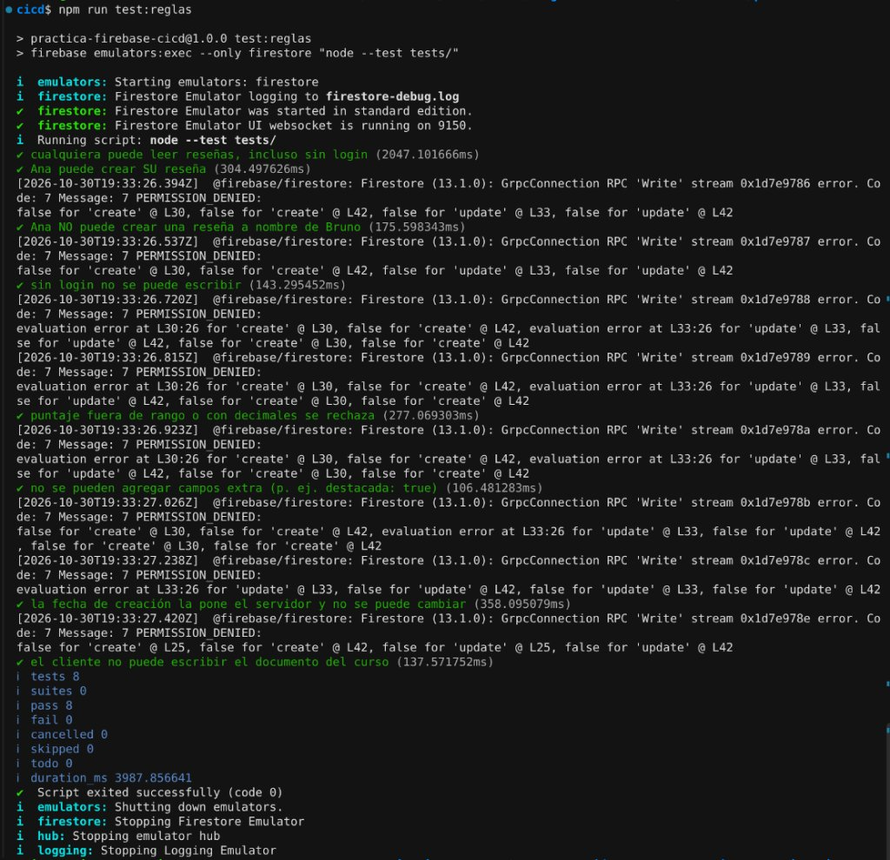
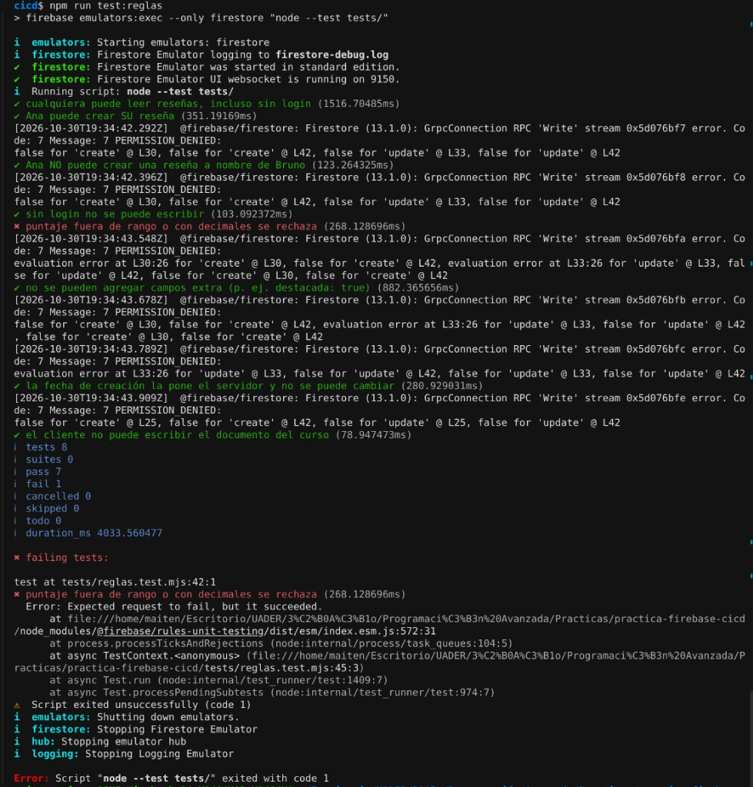
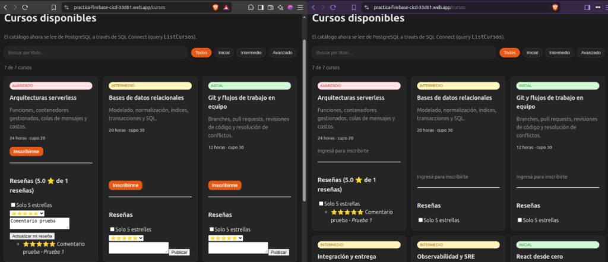

# Reflexión y Evidencia — Prácticas de Programación Avanzada (2026)

---

# Clase 1: Práctica CI/CD con Firebase Hosting y Hardening HTTP

## Medición de Headers (`check-headers.mjs`)

### Antes del hardening (B1 — Medición inicial)

```text
▶ HTML: https://practica-firebase-cicd-33d61.web.app/
  status 200
  ✘ content-security-policy (falta)
  ✔ strict-transport-security: max-age=31556926; includeSubDomains; preload
  ✘ x-content-type-options (falta)
  ✘ x-frame-options (falta)
  ✘ referrer-policy (falta)
  ✘ permissions-policy (falta)
  · cache-control: max-age=3600

▶ Asset estático: /_next/static/chunks/1x6obpmlu1_c2.js
  ✘ cache-control: max-age=3600

❌ 6 control(es) pendiente(s).
```

### Después del hardening (B5 — Medición final en preview / producción)

```text
▶ HTML: https://practica-firebase-cicd-33d61.web.app/
  status 200
  ✔ content-security-policy: default-src 'self'; script-src 'self' 'sha256-…'; style-src 'self' 'unsafe-inline'; img-src 'self' https://pi…
  ✔ strict-transport-security: max-age=63072000; includeSubDomains; preload
  ✔ x-content-type-options: nosniff
  ✔ x-frame-options: DENY
  ✔ referrer-policy: strict-origin-when-cross-origin
  ✔ permissions-policy: camera=(), microphone=(), geolocation=(), payment=(), usb=(), interest-cohort=()
  · cache-control: no-cache

▶ Asset estático: /_next/static/chunks/1x6obpmlu1_c2.js
  ✔ cache-control: public, max-age=31536000, immutable

✅ Todos los controles pasaron.
```

---

## Preguntas de reflexión (Sección 8)

### 1. ¿Por qué el preview tiene vencimiento? ¿Qué riesgos tendría un preview que no vence nunca?
Los preview channels son entornos efímeros creados para validar un Pull Request puntual antes de integrarlo. Configurar un vencimiento (`expires: 3d`) garantiza la limpieza automática de recursos. Si los previews no vencieran nunca:
- **Superficie de ataque permanente ("zombie environments")**: Quedarían publicadas versiones preliminares con bugs, dependencias desactualizadas o configuraciones de seguridad incompletas en URLs públicamente accesibles y indexables si se filtran.
- **Confusión y desalineación**: Usuarios o testers podrían seguir accediendo a versiones obsoletas creyendo que son actuales, o consumir cuotas de almacenamiento/tráfico innecesariamente.

### 2. ¿Qué diferencia hay entre *desplegar* y *liberar*? ¿Dónde aparece cada concepto en este flujo?
- **Desplegar (Deploy)**: Es el acto técnico de compilar artefactos e instalarlos en un entorno de infraestructura (por ejemplo, subir el directorio `out/` a un canal de preview o al almacenamiento de versiones de Firebase Hosting). No implica necesariamente que los usuarios finales reciban ese cambio.
- **Liberar (Release)**: Es el acto de negocio/operativo de exponer una versión ya desplegada al tráfico de los usuarios finales en producción.
- **En nuestro flujo**:
  - Cuando el workflow de PR publica en un *preview channel*, estamos **desplegando** sin liberar al público general.
  - Cuando ejecutamos un **rollback** desde el historial de versiones de Firebase Hosting o promovemos un canal con `firebase hosting:clone <PROJECT_ID>:<CANAL> <PROJECT_ID>:live`, estamos cambiando qué versión apunta al canal `live` (**liberando** o revirtiendo la liberación) en segundos y sin recompilar ni volver a desplegar desde cero.
  - *Nota sobre el estado de `main` tras un rollback (A6)*: Hacer rollback en Firebase Hosting revierte la versión liberada en el CDN, pero `main` en Git sigue conteniendo el commit problemático. Si otro PR se mergea después, volverá a desplegar el código roto a menos que el equipo alinee Git con la realidad operativa mediante un `git revert` en `main`.

### 3. ¿Por qué la clave de la service account va en un secreto y no en el repo? ¿Qué podría hacer alguien que la obtenga? ¿Cómo limitarías el daño?
- **Por qué va en un secreto**: El repositorio es público (y aun si fuera privado, el historial de Git persiste en cada clon). Versionar el JSON de la Service Account expondría credenciales privadas de largo plazo.
- **Impacto de filtración**: Quien obtenga esa clave puede autenticarse contra Google Cloud / Firebase y desplegar contenido malicioso (phishing, malware, defacement) en producción en nombre del proyecto, borrar canales o consumir cuota del plan.
- **Cómo limitar el daño (Principio de mínimo privilegio y defensa en profundidad)**:
  1. **Permisos mínimos (IAM)**: Asignar a la Service Account únicamente el rol `Firebase Hosting Admin` (`roles/firebasehosting.admin`), sin permisos de `Owner`/`Editor` sobre el resto del proyecto GCP.
  2. **Rotación y revocación**: Si se compromete, revocar la clave inmediatamente en IAM y generar una nueva, o mejor aún, reemplazar llaves JSON estáticas por **Workload Identity Federation (OIDC)** entre GitHub Actions y Google Cloud para usar tokens efímeros sin llaves permanentes.
  3. **Restricción en GitHub**: Proteger la rama `main`, no exponer secretos a PRs provenientes de forks y usar GitHub Environments (`production`) con revisores obligatorios.

### 4. La CSP rompió la app: ¿por qué? ¿Qué opciones evaluaste y qué costo de seguridad tiene cada una?
Al aplicar la política base (`default-src 'self'; script-src 'self'; style-src 'self'; img-src 'self'`), se rompieron dos partes:
1. **El filtro interactivo en `/cursos` dejó de funcionar**: Aunque es un export estático (`out/cursos.html`), Next.js App Router inserta etiquetas `<script>` inline (sin atributo `src`, como `self.__next_f.push(...)`) para bootstrapping de Turbopack y para hidratar el payload RSC del Client Component (`FiltroCursos`). Con `script-src 'self'`, el navegador bloquea todo script inline.
2. **La imagen de portada en `/` se bloqueó**: El `` solicita un recurso externo a `picsum.photos`, el cual responde con una redirección HTTP `302` hacia el CDN `https://fastly.picsum.photos/...`. En CSP, las redirecciones requieren autorizar tanto el origen inicial como el origen destino en `img-src`.

**Opciones evaluadas para `script-src` y su costo de seguridad**:
- **Opción A (`'unsafe-inline'`)**: Permitir cualquier script inline. *Costo de seguridad alto*: neutraliza la principal defensa de CSP contra Cross-Site Scripting (XSS), ya que cualquier inyección HTML lograría ejecutar JS arbitrario.
- **Opción B (`nonce-<valor>`)**: Inviable en Firebase Hosting (plan Spark / export estático), porque un nonce debe generarse aleatoriamente en cada request HTTP y no existe un servidor dinámico que reescriba el HTML por petición.
- **Opción C (Elegida — Hashes `'sha256-...'` calculados en el pipeline)**: Se implementó `scripts/generate-csp-hashes.mjs`, que corre automáticamente al finalizar `next build`, extrae todos los bloques `<script>` inline de `out/**/*.html`, calcula sus hashes SHA-256 y actualiza la directiva `script-src 'self' 'sha256-...'` en `firebase.json`. *Costo de seguridad mínimo*: mantiene el bloqueo total contra scripts inyectados por atacantes, autorizando exclusivamente los scripts inmutables generados en el build. (En `style-src` se habilitó `'unsafe-inline'` para estilos de atributos internos de React/Next.js, cuyo riesgo es significativamente menor que en `script-src`).

### 5. Para cada header de B2, ¿qué ataque mitiga?
- **`Strict-Transport-Security` (HSTS)**: Mitiga ataques **Man-in-the-Middle (MitM) / SSL Stripping** (como `sslstrip`) y secuestro de sesión en redes no confiables, obligando al navegador a conectarse exclusivamente por HTTPS durante el `max-age` definido.
- **`X-Content-Type-Options: nosniff`**: Mitiga ataques de **MIME Confusion / MIME Sniffing**, impidiendo que el navegador ignore el `Content-Type` declarado y ejecute archivos estáticos o subidos por usuarios como si fueran HTML o JavaScript ejecutable.
- **`X-Frame-Options: DENY`** (junto con `frame-ancestors 'none'` en CSP): Mitiga ataques de **Clickjacking (UI Redressing)**, impidiendo que un sitio malicioso embeba nuestra aplicación dentro de un `<iframe>` invisible para engañar al usuario y hacerle clickear elementos sin saberlo.
- **`Referrer-Policy: strict-origin-when-cross-origin`**: Mitiga la **fuga de información sensible en URLs (Information Disclosure)** hacia terceros; cuando se navega hacia otro dominio, solo envía el origen (`https://dominio`) y oculta la ruta específica y los query parameters.
- **`Permissions-Policy`**: Mitiga el **abuso de APIs sensibles del navegador** (cámara, micrófono, geolocalización, USB, pagos) en caso de compromiso de dependencias de terceros o XSS, aplicando el principio de mínimo privilegio en el cliente.
- **`Cross-Origin-Opener-Policy: same-origin` (Adicional)**: Mitiga ataques de **Reverse Tabnabbing** y aislamiento de procesos (Spectre/cross-origin leaks) al cortar la referencia `window.opener` con documentos de otros orígenes.

### 6. ¿Por qué los assets de `/_next/static/` pueden cachearse un año y el HTML no?
- **Assets en `/_next/static/**` (`public, max-age=31536000, immutable`)**: Next.js aplica *content addressing* (fingerprinting): el nombre de cada archivo JS/CSS incluye un hash criptográfico derivado de su contenido (ej. `1x6obpmlu1_c2.js`). Si cambia una sola línea de código en un nuevo build, el archivo generado tendrá otro nombre distinto. Por ende, un nombre dado jamás cambia de contenido y puede cachearse por 1 año sin riesgo de servir código viejo.
- **Archivos HTML (`no-cache`)**: Las rutas como `/` (`index.html`) o `/cursos` (`cursos.html`) tienen URLs fijas que no cambian entre versiones y actúan como el punto de entrada que referencia qué nombres de chunks de `/_next/static/` deben cargarse. Si el HTML se cacheara sin revalidar (por ejemplo, `max-age=3600` o superior), tras un deploy o un rollback de emergencia los usuarios seguirían viendo la versión vieja hasta que expire su caché local, o tendrían inconsistencias de versiones. Con `no-cache`, el navegador revalida el ETag del HTML en cada visita y, si hubo un deploy o rollback, descarga el nuevo HTML inmediatamente mientras reutiliza los chunks estáticos que no hayan cambiado.

### 7. Si la app necesitara SSR, ¿qué cambiaría en la arquitectura, en la CSP y en el costo?
- **En la arquitectura**: Ya no alcanzaría con servir archivos estáticos pregenerados en `out/` mediante el CDN de Firebase Hosting. Habría que quitar `output: "export"` de `next.config.ts` y desplegar un runtime de Node.js (por ejemplo, usando **Firebase App Hosting** o **Cloud Run** detrás del CDN de Firebase Hosting) capaz de ejecutar código en el servidor en cada petición o Server Action.
- **En la CSP**: Al existir un servidor que procesa cada request dinámicamente (vía `middleware.ts` de Next.js), podríamos generar un **nonce criptográfico único por request** (`script-src 'self' 'nonce-...' 'strict-dynamic'`), inyectándolo en el header HTTP de respuesta y en los `<script>` renderizados en esa petición, en lugar de precalcular hashes estáticos sobre archivos en disco.
- **En el costo**: Se perdería el costo cero garantizado del plan **Spark** (que solo cubre almacenamiento y transferencia estática dentro de límites gratuitos). Tanto Firebase App Hosting como Cloud Run / Cloud Functions exigen pasar al **plan Blaze (pago por uso con tarjeta de crédito asociada)**, sumando costos por tiempo de CPU/memoria de ejecución de contenedores, invocaciones, Cloud Build y Artifact Registry.

---

# Clase 2: SQL con Firebase SQL Connect — Modelo Relacional y Autorización

## 1. Auditoría de Seguridad (`npm run atacar`) — Entregable 2

### Antes de corregir la fuga (L4 vulnerable)

```text
$ npm run atacar

> practica-firebase-cicd@1.0.0 atacar
> node scripts/atacar.mjs

Auditoría de SQL Connect · proyecto practica-firebase-cicd-33d61 · emuladores locales

✔ ListCursos responde sin login (7 cursos) — público por diseño
✘ ListAlumnos devuelve datos personales SIN login
    Ejemplo filtrado: {"email":"ana@ejemplo.test","id":"seed-uid-ana","nombre":"Ana Ficticia"}
[2026-10-29T17:14:33.645Z]  @firebase/data-connect: DataConnect (13.1.0): Error while performing request: {"code":16,"message":"unauthenticated: this operation requires a signed-in user","details":[{"@type":"type.googleapis.com/google.firebase.dataconnect.http.GraphqlError","message":"@auth rejected the request","locations":[],"path":null,"extensions":{"file":"","code":"UNAUTHENTICATED","debugDetails":"@auth(level: USER) requires a signed-in user","resource":"","warningLevel":"WARNING_LEVEL_UNKNOWN","workarounds":[]}}]}
✔ Inscribirme rechazada sin login
    unauthenticated: this operation requires a signed-in user
✔ Inscribirme es idempotente (repetir no falla)
✔ MisInscripciones solo devuelve lo del usuario que llama
✔ B no puede dar de baja a A

❌ 1 vulnerabilidad(es) · 0 pendiente(s)
```

### Después de corregir L4 (`@auth(level: NO_ACCESS)`)

```text
$ npm run atacar

> practica-firebase-cicd@1.0.0 atacar
> node scripts/atacar.mjs

Auditoría de SQL Connect · proyecto practica-firebase-cicd-33d61 · emuladores locales

✔ ListCursos responde sin login (7 cursos) — público por diseño
[2026-10-29T17:22:18.153Z]  @firebase/data-connect: DataConnect (13.1.0): Error while performing request: {"code":7,"message":"unauthorized: you are not authorized to perform this operation","details":[{"@type":"type.googleapis.com/google.firebase.dataconnect.http.GraphqlError","message":"@auth rejected the request","locations":[],"path":null,"extensions":{"file":"","code":"PERMISSION_DENIED","debugDetails":"@auth(level: NO_ACCESS) always reject non-admin requests","resource":"","warningLevel":"WARNING_LEVEL_UNKNOWN","workarounds":[]}}]}
✔ ListAlumnos rechazada para un cliente
    unauthorized: you are not authorized to perform this operation
[2026-10-29T17:22:18.169Z]  @firebase/data-connect: DataConnect (13.1.0): Error while performing request: {"code":16,"message":"unauthenticated: this operation requires a signed-in user","details":[{"@type":"type.googleapis.com/google.firebase.dataconnect.http.GraphqlError","message":"@auth rejected the request","locations":[],"path":null,"extensions":{"file":"","code":"UNAUTHENTICATED","debugDetails":"@auth(level: USER) requires a signed-in user","resource":"","warningLevel":"WARNING_LEVEL_UNKNOWN","workarounds":[]}}]}
✔ Inscribirme rechazada sin login
    unauthenticated: this operation requires a signed-in user
✔ Inscribirme es idempotente (repetir no falla)
✔ MisInscripciones solo devuelve lo del usuario que llama
✔ B no puede dar de baja a A

✅ Todos los controles pasaron
```

---

## 2. Preguntas de reflexión — Clase 2 (Sección 10)

### 1. ¿Por qué ninguna operación de este conector recibe el id del alumno como variable? ¿Qué es IDOR y cómo lo evita `auth.uid`?
- **Qué es IDOR (Insecure Direct Object Reference — OWASP API1: Broken Object Level Authorization)**: Es una vulnerabilidad donde la API confía en un identificador enviado por el cliente (por ejemplo, `$alumnoId` en el body, query string o variables GraphQL) para acceder o modificar recursos sin verificar que dicho identificador pertenezca al usuario que realiza la petición.
- **Qué pasaría si se recibiera `$alumnoId` como variable**: Como el bundle del cliente es público y cualquiera puede invocar las operaciones del conector directamente, un atacante podría enviar el `uid` de otro alumno en `MisInscripciones($alumnoId)`, `Inscribirme($alumnoId, $cursoId)` o `DarmeDeBaja($alumnoId, $cursoId)` para espiar sus cursos, inscribirlo sin su consentimiento o darle de baja.
- **Cómo lo evita `auth.uid` (`_expr: "auth.uid"`)**: Al usar expresiones de servidor (`id_expr: "auth.uid"` y `alumnoId_expr: "auth.uid"`), la operación **no acepta el identificador desde el cliente**. El servidor de SQL Connect extrae el `uid` directamente del token JWT firmado criptográficamente por Firebase Auth. Así, cada usuario queda estrictamente confinado a leer, insertar o borrar únicamente sus propias filas.

### 2. `ListCursos` es `PUBLIC` y `ListAlumnos` terminó en `NO_ACCESS`. ¿Qué criterio usaste? ¿Cómo haría el "panel de admin" para listar alumnos?
- **Criterio aplicado (Clasificación de datos y Principio de Mínimo Privilegio)**:
  - `ListCursos` expone el catálogo de oferta académica, que es información pública por requerimiento de negocio (cualquier visitante debe poder consultar los cursos antes de registrarse); por eso se declara `@auth(level: PUBLIC)` con su `insecureReason` explícito.
  - `ListAlumnos` devuelve **datos personales identificables (PII)**: `id`, `nombre` y `email` de todos los usuarios registrados. Dejarla en `PUBLIC` permitía a cualquier anónimo descargar la base de usuarios, y cambiarla a `USER` seguiría siendo vulnerable porque cualquier alumno autenticado podría listar los correos y nombres de todos sus compañeros. Como ningún flujo de la aplicación cliente necesita listar alumnos, corresponde `@auth(level: NO_ACCESS)`.
- **Cómo resolver el "panel de admin" sin exponer datos**:
  1. **Vía backend administrativo / Cloud Functions / CLI**: Las operaciones con `NO_ACCESS` solo bloquean llamadas desde los SDKs de cliente, pero pueden seguir ejecutándose desde entornos de servidor autenticados con credenciales de **Google Cloud IAM** (por ejemplo, mediante Firebase Admin SDK o desde la consola de Cloud/Firebase).
  2. **Vía Custom Claims en Firebase Auth (si el panel fuera una app cliente)**: Si existiera un frontend de administración, se asignaría un custom claim (`admin: true`) al token de los administradores desde el Admin SDK y se crearía una operación específica protegida con una expresión CEL en el servidor: `@auth(expr: "auth.token.admin == true")`.

### 3. ¿Qué ventaja tiene una clave primaria compuesta en `Matricula` frente a validar duplicados en el código del cliente? (`insert` vs `upsert` y restricciones adicionales)
- **Integridad garantizada en el motor relacional**:
  1. **Seguridad frente a clientes que saltean la UI**: Las validaciones en el frontend son puramente cosméticas para la experiencia de usuario; un atacante puede llamar directamente al endpoint de SQL Connect ignorando la interfaz.
  2. **Prevención de condiciones de carrera (TOCTOU — Time-of-Check to Time-of-Use)**: Si se validara leyendo primero si existe la inscripción y luego insertando, dos peticiones concurrentes pasarían la verificación al mismo tiempo y crearían registros duplicados. Declarar `@table(key: ["alumno", "curso"])` traduce la regla a un constraint `PRIMARY KEY (alumno_id, curso_id)` en PostgreSQL, haciendo imposible a nivel físico que existan dos filas para el mismo par `(alumno, curso)`.
- **Diferencia entre `matricula_insert` y `matricula_upsert` (L2)**:
  - `matricula_insert` ejecuta un `INSERT INTO matricula ...` puro; si el alumno intenta inscribirse por segunda vez al mismo curso, PostgreSQL arroja un error de violación de clave primaria (`duplicate key value violates unique constraint`).
  - `matricula_upsert` ejecuta un `INSERT ... ON CONFLICT (alumno_id, curso_id) DO UPDATE ...`, logrando que la operación `Inscribirme` sea **idempotente**: repetir la petición mantiene una única inscripción sin fallar ni duplicar filas.
- **Índices y restricciones adicionales propuestas para producción (Nivel Destacado — L1)**:
  - **Índice sobre `curso_id`**: La clave primaria compuesta `(alumno_id, curso_id)` indexa eficientemente las búsquedas por `alumno_id` (como `MisInscripciones`), pero para consultar todos los inscriptos de un curso o contar vacantes ocupadas por curso conviene un índice adicional `CREATE INDEX idx_matricula_curso ON matricula(curso_id)` (o `@index` en el campo `curso`).
  - **Restricción de dominio y control de cupo**: Agregar un `CHECK (cupo >= 0)` y `CHECK (horas > 0)` en `Curso`, y un trigger en PostgreSQL (o validación transaccional) que verifique que `COUNT(*) WHERE curso_id = NEW.curso_id < curso.cupo` antes de permitir el `INSERT` en `Matricula`.

### 4. La configuración de Firebase (`apiKey`, etc.) es pública. ¿Por qué eso no compromete la base de datos? ¿Qué capa faltaría para frenar a alguien que usa esa config desde un script?
- **Por qué la `apiKey` pública no compromete la base**: En Firebase, la `apiKey` no es un secreto de autorización sino un identificador de proyecto para enrutar las peticiones hacia la infraestructura correcta. La seguridad de los datos reside en el servidor:
  1. SQL Connect **no acepta SQL arbitrario** desde el cliente; solo permite invocar por nombre las operaciones `.gql` precompiladas en el conector desplegado.
  2. Cada operación valida en el servidor su directiva `@auth` y extrae la identidad real (`auth.uid`, `auth.token.email`) del JWT firmado por Firebase Auth, no de parámetros manipulables.
- **Qué capa falta para frenar scripts automatizados (`Firebase App Check`)**:
  Aunque un script externo (como `scripts/atacar.mjs`) no puede violar las reglas de `@auth`, sí puede usar la `apiKey` pública para consumir cuota de lecturas públicas (`ListCursos`) o automatizar la creación masiva de cuentas en Firebase Auth (abuso de facturación / denegación de servicio). La capa que falta es **Firebase App Check** (con un proveedor de atestación como **reCAPTCHA Enterprise** en web): App Check exige que cada request incluya un token de atestación que prueba que la llamada proviene de nuestra aplicación web legítima corriendo en un navegador real y en nuestro dominio autorizado, bloqueando scripts de Node.js, `curl` o clientes no oficiales antes de que lleguen a la base.

### 5. Comparado con una API REST propia (`Express + pg`) y con Firestore Rules, ¿qué te da SQL Connect y qué perdés?
- **Frente a una API REST propia (`Express + pg`)**:
  - **Qué te da SQL Connect**: Eliminación de código repetitivo (boilerplate) de backend; generación automática de migraciones DDL de PostgreSQL a partir de `schema.gql`; prevención de inyección SQL por diseño (queries parametrizadas compiladas en el servidor); autorización declarativa co-localizada en cada operación (`@auth`); tipado extremo a extremo y despliegue sin mantener servidores Node.js propios (arquitectura *serverless* compatible con frontend estático).
  - **Qué perdés**: Flexibilidad para ejecutar lógica de negocio imperativa compleja antes o después de una consulta (por ejemplo, enviar un email transaccional, llamar a una pasarela de pagos externa, usar transacciones multi-paso con lógica condicional o integrar librerías de terceros en el mismo endpoint), además de cierto acoplamiento (*vendor lock-in*) a las directivas de Firebase Data Connect.
- **Frente a Firestore Security Rules**:
  - En **Firestore**, el modelo es NoSQL documental y el cliente arma las consultas dinámicamente desde el navegador, mientras las *Firestore Rules* evalúan permisos a nivel de documento/camino. Si una regla queda mal escrita o si se requiere cruzar varias colecciones con integridad referencial, el cliente tiene demasiada libertad de consulta y no existen *foreign keys* ni *joins* reales.
  - En **SQL Connect**, el modelo es **PostgreSQL relacional real** (con claves foráneas, claves compuestas y tipos estrictos) y la autorización es **a nivel de operación con nombre** (*stored queries* GraphQL): el cliente nunca decide qué tablas o columnas cruzar ni qué filtros aplicar, solo invoca el nombre de la operación autorizada.

### 6. ¿Por qué no alcanzó con la CSP de la clase 1 y por qué conviene listar dominios exactos en `connect-src`? (Análisis de producción y migración SQL)
- **Por qué no alcanzó con `connect-src 'self'` de la Clase 1**: En la Clase 1 los cursos estaban embebidos estáticamente en el código y la aplicación no hacía peticiones `fetch`/`XHR` a servicios externos. En la Clase 2, el navegador necesita comunicarse por red desde el cliente con tres servicios remotos de Firebase:
  1. `https://identitytoolkit.googleapis.com`: API de Firebase Auth para registro (`signUp`), login (`signInWithPassword`) y actualización de perfil (`update`).
  2. `https://securetoken.googleapis.com`: API de Firebase Auth para renovación/refresco de tokens JWT (`getIdToken(true)`), indispensable al registrar al alumno antes de insertar su fila en PostgreSQL.
  3. `https://firebasedataconnect.googleapis.com`: Endpoint de producción de Firebase SQL Connect para ejecutar las queries y mutations del conector.
- **Por qué listar dominios exactos y NO usar comodines como `https://*.googleapis.com`**:
  Bajo `*.googleapis.com` operan decenas de servicios públicos de Google Cloud ( entre ellos `https://storage.googleapis.com`, Google Drive API, Firebase Realtime Database o Cloud Functions de cualquier proyecto de terceros). Si un atacante lograra una inyección o comprometiera una dependencia, un comodín `https://*.googleapis.com` en `connect-src` le permitiría **exfiltrar datos sensibles** (tokens, PII) hacia un bucket de Cloud Storage controlado por el atacante (`storage.googleapis.com/bucket-atacante`) sin que el navegador lo bloquee. Listar únicamente los tres orígenes exactos aplica el principio de mínimo privilegio a nivel de red en el navegador.
- **Análisis de la migración SQL en el deploy (`dataconnect:sql:diff` / L7)**:
  Al ejecutar el deploy de SQL Connect, la herramienta compara el esquema declarativo (`schema.gql`) contra el catálogo de PostgreSQL en Cloud SQL y genera las sentencias DDL correspondientes: creación de las tablas `"public"."curso"`, `"public"."alumno"` (con `id VARCHAR PRIMARY KEY`) y `"public"."matricula"`, definiendo `PRIMARY KEY ("alumno_id", "curso_id")` y las restricciones `FOREIGN KEY ("alumno_id") REFERENCES "public"."alumno" ("id") ON DELETE CASCADE` y `FOREIGN KEY ("curso_id") REFERENCES "public"."curso" ("id") ON DELETE CASCADE`, garantizando la integridad referencial en la base de producción.

---

## Práctica 4 · Firestore

### 1. Evidencia de Tests de Reglas (`npm run test:reglas`) — Entregable 2

#### A. Todos los tests en verde (`d.puntaje <= 5` en `firestore.rules`)



```text
$ npm run test:reglas

> practica-firebase-cicd@1.0.0 test:reglas
> firebase emulators:exec --only firestore "node --test tests/"

i  emulators: Starting emulators: firestore
i  firestore: Firestore Emulator logging to firestore-debug.log
✔  firestore: Firestore Emulator was started in standard edition.
✔  firestore: Firestore Emulator UI websocket is running on 9150.
i  Running script: node --test tests/
✔ cualquiera puede leer reseñas, incluso sin login (2047.101666ms)
✔ Ana puede crear SU reseña (304.497626ms)
[2026-10-30T19:33:26.394Z]  @firebase/firestore: Firestore (13.1.0): GrpcConnection RPC 'Write' stream 0x1d7e9786 error. Code: 7 Message: 7 PERMISSION_DENIED: 
false for 'create' @ L30, false for 'create' @ L42, false for 'update' @ L33, false for 'update' @ L42
✔ Ana NO puede crear una reseña a nombre de Bruno (175.598343ms)
[2026-10-30T19:33:26.537Z]  @firebase/firestore: Firestore (13.1.0): GrpcConnection RPC 'Write' stream 0x1d7e9787 error. Code: 7 Message: 7 PERMISSION_DENIED: 
false for 'create' @ L30, false for 'create' @ L42, false for 'update' @ L33, false for 'update' @ L42
✔ sin login no se puede escribir (143.295452ms)
[2026-10-30T19:33:26.720Z]  @firebase/firestore: Firestore (13.1.0): GrpcConnection RPC 'Write' stream 0x1d7e9788 error. Code: 7 Message: 7 PERMISSION_DENIED: 
evaluation error at L30:26 for 'create' @ L30, false for 'create' @ L42, evaluation error at L33:26 for 'update' @ L33, false for 'update' @ L42, false for 'create' @ L30, false for 'create' @ L42
[2026-10-30T19:33:26.815Z]  @firebase/firestore: Firestore (13.1.0): GrpcConnection RPC 'Write' stream 0x1d7e9789 error. Code: 7 Message: 7 PERMISSION_DENIED: 
evaluation error at L30:26 for 'create' @ L30, false for 'create' @ L42, evaluation error at L33:26 for 'update' @ L33, false for 'update' @ L42, false for 'create' @ L30, false for 'create' @ L42
✔ puntaje fuera de rango o con decimales se rechaza (277.069303ms)
[2026-10-30T19:33:26.923Z]  @firebase/firestore: Firestore (13.1.0): GrpcConnection RPC 'Write' stream 0x1d7e978a error. Code: 7 Message: 7 PERMISSION_DENIED: 
evaluation error at L30:26 for 'create' @ L30, false for 'create' @ L42, evaluation error at L33:26 for 'update' @ L33, false for 'update' @ L42, false for 'create' @ L30, false for 'create' @ L42
✔ no se pueden agregar campos extra (p. ej. destacada: true) (106.481283ms)
[2026-10-30T19:33:27.026Z]  @firebase/firestore: Firestore (13.1.0): GrpcConnection RPC 'Write' stream 0x1d7e978b error. Code: 7 Message: 7 PERMISSION_DENIED: 
false for 'create' @ L30, false for 'create' @ L42, evaluation error at L33:26 for 'update' @ L33, false for 'update' @ L42, false for 'create' @ L30, false for 'create' @ L42
[2026-10-30T19:33:27.238Z]  @firebase/firestore: Firestore (13.1.0): GrpcConnection RPC 'Write' stream 0x1d7e978c error. Code: 7 Message: 7 PERMISSION_DENIED: 
evaluation error at L33:26 for 'update' @ L33, false for 'update' @ L42, false for 'update' @ L33, false for 'update' @ L42
✔ la fecha de creación la pone el servidor y no se puede cambiar (358.095079ms)
[2026-10-30T19:33:27.420Z]  @firebase/firestore: Firestore (13.1.0): GrpcConnection RPC 'Write' stream 0x1d7e978e error. Code: 7 Message: 7 PERMISSION_DENIED: 
false for 'create' @ L25, false for 'create' @ L42, false for 'update' @ L25, false for 'update' @ L42
✔ el cliente no puede escribir el documento del curso (137.571752ms)
ℹ tests 8
ℹ suites 0
ℹ pass 8
ℹ fail 0
ℹ cancelled 0
ℹ skipped 0
ℹ todo 0
ℹ duration_ms 3987.856641
✔  Script exited successfully (code 0)
i  emulators: Shutting down emulators.
i  firestore: Stopping Firestore Emulator
i  hub: Stopping emulator hub
i  logging: Stopping Logging Emulator
```

#### B. Prueba de "hacerlo fallar a propósito" (cambiando `d.puntaje <= 5` por `d.puntaje <= 6`)

Al relajar la regla a `d.puntaje <= 6`, el test `"puntaje fuera de rango o con decimales se rechaza"` falla inmediatamente en `tests/reglas.test.mjs:45:3` porque `assertFails(setDoc(ref, resena({ puntaje: 6 })))` esperaba que la escritura fuera rechazada por las Security Rules, pero el emulador la permitió:



```text
$ npm run test:reglas
> firebase emulators:exec --only firestore "node --test tests/"

i  emulators: Starting emulators: firestore
i  firestore: Firestore Emulator logging to firestore-debug.log
✔  firestore: Firestore Emulator was started in standard edition.
✔  firestore: Firestore Emulator UI websocket is running on 9150.
i  Running script: node --test tests/
✔ cualquiera puede leer reseñas, incluso sin login (1516.70485ms)
✔ Ana puede crear SU reseña (351.19169ms)
[2026-10-30T19:34:42.292Z]  @firebase/firestore: Firestore (13.1.0): GrpcConnection RPC 'Write' stream 0x5d076bf7 error. Code: 7 Message: 7 PERMISSION_DENIED: 
false for 'create' @ L30, false for 'create' @ L42, false for 'update' @ L33, false for 'update' @ L42
✔ Ana NO puede crear una reseña a nombre de Bruno (123.264325ms)
[2026-10-30T19:34:42.396Z]  @firebase/firestore: Firestore (13.1.0): GrpcConnection RPC 'Write' stream 0x5d076bf8 error. Code: 7 Message: 7 PERMISSION_DENIED: 
false for 'create' @ L30, false for 'create' @ L42, false for 'update' @ L33, false for 'update' @ L42
✔ sin login no se puede escribir (103.092372ms)
✖ puntaje fuera de rango o con decimales se rechaza (268.128696ms)
[2026-10-30T19:34:43.548Z]  @firebase/firestore: Firestore (13.1.0): GrpcConnection RPC 'Write' stream 0x5d076bfa error. Code: 7 Message: 7 PERMISSION_DENIED: 
evaluation error at L30:26 for 'create' @ L30, false for 'create' @ L42, evaluation error at L33:26 for 'update' @ L33, false for 'update' @ L42, false for 'create' @ L30, false for 'create' @ L42
✔ no se pueden agregar campos extra (p. ej. destacada: true) (882.365656ms)
[2026-10-30T19:34:43.678Z]  @firebase/firestore: Firestore (13.1.0): GrpcConnection RPC 'Write' stream 0x5d076bfb error. Code: 7 Message: 7 PERMISSION_DENIED: 
false for 'create' @ L30, false for 'create' @ L42, evaluation error at L33:26 for 'update' @ L33, false for 'update' @ L42, false for 'create' @ L30, false for 'create' @ L42
[2026-10-30T19:34:43.789Z]  @firebase/firestore: Firestore (13.1.0): GrpcConnection RPC 'Write' stream 0x5d076bfc error. Code: 7 Message: 7 PERMISSION_DENIED: 
evaluation error at L33:26 for 'update' @ L33, false for 'update' @ L42, false for 'update' @ L33, false for 'update' @ L42
✔ la fecha de creación la pone el servidor y no se puede cambiar (280.929031ms)
[2026-10-30T19:34:43.909Z]  @firebase/firestore: Firestore (13.1.0): GrpcConnection RPC 'Write' stream 0x5d076bfe error. Code: 7 Message: 7 PERMISSION_DENIED: 
false for 'create' @ L25, false for 'create' @ L42, false for 'update' @ L25, false for 'update' @ L42
✔ el cliente no puede escribir el documento del curso (78.947473ms)
ℹ tests 8
ℹ suites 0
ℹ pass 7
ℹ fail 1
ℹ cancelled 0
ℹ skipped 0
ℹ todo 0
ℹ duration_ms 4033.560477

✖ failing tests:

test at tests/reglas.test.mjs:42:1
✖ puntaje fuera de rango o con decimales se rechaza (268.128696ms)
  Error: Expected request to fail, but it succeeded.
      at file:///home/maiten/Escritorio/UADER/3%C2%B0A%C3%B1o/Programaci%C3%B3n%20Avanzada/Practicas/practica-firebase-cicd/node_modules/@firebase/rules-unit-testing/dist/esm/index.esm.js:572:31
      at process.processTicksAndRejections (node:internal/process/task_queues:104:5)
      at async TestContext.<anonymous> (file:///home/maiten/Escritorio/UADER/3%C2%B0A%C3%B1o/Programaci%C3%B3n%20Avanzada/Practicas/practica-firebase-cicd/tests/reglas.test.mjs:45:3)
      at async Test.run (node:internal/test_runner/test:1409:7)
      at async Test.processPendingSubtests (node:internal/test_runner/test:974:7)
⚠  Script exited unsuccessfully (code 1)
i  emulators: Shutting down emulators.
i  firestore: Stopping Firestore Emulator
i  hub: Stopping emulator hub
i  logging: Stopping Logging Emulator

Error: Script "node --test tests/" exited with code 1
```

---

### 2. Evidencia de Actualización en Tiempo Real en Producción (`onSnapshot`) — Entregable 3

En la siguiente captura se observan dos sesiones de navegador en paralelo sobre el entorno de producción (`https://practica-firebase-cicd-33d61.web.app/cursos`):
- **Izquierda (usuario autenticado `Prueba 1`)**: publica la reseña `"Comentario prueba"` con 5 estrellas en el curso *Arquitecturas serverless* (el botón cambia a `"Actualizar mi reseña"`).
- **Derecha (ventana privada sin sesión iniciada)**: recibe la reseña instantáneamente vía WebChannel (`onSnapshot`) sin recargar la página y actualiza el resumen de agregación a `5.0 ⭐ de 1 reseñas`.



---

### 3. Preguntas de reflexión — Práctica 4 (Sección 11)

#### 1. ¿Por qué el id del documento es el UID? ¿Qué tendrías que agregar (en reglas o en código) si usaras ids aleatorios con `addDoc`?
- **Por qué el ID del documento es el UID (`cursos/{cursoId}/resenas/{uid}`)**:
  En Firestore los identificadores de documento dentro de una misma subcolección son únicos por definición. Al usar el `uid` de Firebase Auth como clave primaria del documento:
  1. **Regla de negocio garantizada por estructura**: Es físicamente imposible que una misma persona cree dos documentos distintos dentro de `cursos/{cursoId}/resenas/`. Publicar por segunda vez sobrescribe/actualiza el mismo documento (`setDoc`).
  2. **Autorización determinística y sin lecturas extra en Security Rules**: En `firestore.rules`, el comodín `match /resenas/{uid}` captura el ID del documento y permite validar propiedad en $O(1)$ comparando `request.auth.uid == uid` (`esDuenio(uid)`), sin gastar lecturas adicionales (`get()`/`exists()`).
- **Qué habría que cambiar si se usaran IDs aleatorios con `addDoc`**:
  1. **En el modelo y en las reglas**: Habría que guardar obligatoriamente un campo `uid` (o `autorUid`) dentro del body del documento y validar en `firestore.rules`:
     - En `create`: `request.resource.data.uid == request.auth.uid`.
     - En `update`: `resource.data.uid == request.auth.uid && request.resource.data.uid == resource.data.uid` (para que nadie transfiera la autoría).
     - En `delete`: `resource.data.uid == request.auth.uid`.
  2. **El gran problema (unicidad rota)**: Las Security Rules de Firestore **no pueden ejecutar queries (`where("uid", "==", request.auth.uid)`)** para verificar si ya existe otra reseña del mismo usuario en la subcolección. Con `addDoc` e IDs aleatorios, aunque el código del frontend intente buscar primero si el usuario ya opinó, un usuario malicioso desde la consola podría llamar a `addDoc` 1.000 veces y crear 1.000 reseñas distintas para inflar el promedio del curso. La única forma de mantener "1 reseña por usuario" en Firestore sin backend intermedio es que la clave determinística del documento sea el `uid` (o mantener un documento índice auxiliar validado con `existsAfter` en un `writeBatch`).

#### 2. La reseña guarda una copia del nombre del autor. ¿Qué ganás y qué perdés con esa desnormalización? ¿Cómo resolverías el cambio de nombre?
- **Qué ganás (optimización de lecturas y latencia)**:
  En Firestore no existen `JOIN`s del lado del servidor y **se factura por documento leído**. Al copiar `autor: usuario.displayName` dentro de cada documento de `resenas`, renderizar una lista de 20 reseñas cuesta únicamente **20 lecturas** (1 snapshot con 20 documentos) y 1 sola ida y vuelta de red. Si solo guardáramos el `uid` normalizado, el cliente tendría que hacer hasta 20 lecturas adicionales a una colección `/usuarios/{uid}` (duplicando el costo a 40 lecturas por visita y agregando latencia en cascada).
- **Qué perdés (consistencia eventual / datos obsoletos)**:
  Perdés una única fuente de verdad (*Single Source of Truth*) para el nombre. Si el usuario cambia su `displayName` en su perfil, las reseñas que escribió en el pasado quedan con el nombre viejo.
- **Cómo resolver el cambio de nombre (estrategias arquitectónicas)**:
  1. **Propagación asíncrona en background (Fan-out con Cloud Functions)**: Cuando el usuario actualiza su perfil en la colección `usuarios/{uid}` (o vía función callable), una **Cloud Function** dispara una consulta `collectionGroup("resenas").where("uid", "==", uid)` desde el Admin SDK y actualiza el campo `autor` en lote mediante `WriteBatch` (hasta 500 documentos por batch). Es el patrón estándar en NoSQL cuando las lecturas superan ampliamente a los cambios de nombre.
  2. **Política de negocio ("snapshot histórico")**: En sistemas donde el cambio de nombre es infrecuente o donde interesa conservar el nombre al momento de la emisión (como facturas o auditorías), se acepta la desnormalización tal cual o se actualiza el nombre únicamente cuando el usuario edita su reseña.

#### 3. ¿Qué diferencia hay entre `resource.data` y `request.resource.data`? Dá un ejemplo de regla que use ambos.
- **Diferencia conceptual**:
  - `resource.data`: Representa el estado **actual** del documento que **ya está almacenado en Firestore antes** de que se ejecute la operación. Existe en operaciones `read`, `update` y `delete` (en `create` es `null` porque el documento aún no existe).
  - `request.resource.data`: Representa el estado **futuro/resultante** completo que tendrá el documento **si la escritura se acepta** (ya habiendo aplicado un `merge: true` o `updateDoc` parcial). Existe en operaciones `create` y `update` (en `delete` es `null`).
- **Ejemplos concretos que usan ambos en una regla `update`**:
  1. **Inmutabilidad de la fecha de creación (usado en nuestra práctica)**:
     ```javascript
     allow update: if esDuenio(uid)
       && resenaValida()
       && request.resource.data.creadaEn == resource.data.creadaEn;
     ```
     Compara el valor que quedaría guardado (`request.resource.data.creadaEn`) contra el valor original que ya estaba en la base (`resource.data.creadaEn`), impidiendo que el autor adultere la antigüedad de su reseña al editarla.
  2. **Otro ejemplo práctico (contador monotónico o bloqueo de edición tras moderación)**:
     Impedir que un autor edite su reseña si ya fue marcada como `bloqueada` en la base, o exigir que un contador de versión aumente en exactamente 1:
     ```javascript
     allow update: if esDuenio(uid)
       && resource.data.bloqueada == false
       && request.resource.data.version == resource.data.version + 1;
     ```

#### 4. ¿Por qué la regla de creación exige `creadaEn == request.time` en lugar de confiar en la fecha del cliente?
- **El cliente es un entorno no confiable**: El reloj de la máquina del usuario puede estar desconfigurado involuntariamente (otra zona horaria, pila de BIOS agotada) o puede ser manipulado deliberadamente desde la consola del navegador enviando `Timestamp.fromDate(new Date(2099, 0, 1))`.
- **Impacto de negocio si se confiara en el cliente**: Como la lista de reseñas se ordena con `orderBy("creadaEn", "desc")` y `limit(20)`, si un usuario enviara una fecha en el año 2099, su reseña quedaría **fijada permanentemente en el primer lugar** de la lista por encima de todas las reseñas reales futuras (*pinning attack*), o podría falsificar que opinó hace años.
- **Cómo funciona `request.resource.data.creadaEn == request.time`**:
  Cuando el cliente invoca `serverTimestamp()`, el SDK envía un token centinela especial al servidor de Firestore. Al procesar la escritura, el motor de Firestore reemplaza ese centinela por la marca de tiempo exacta de la transacción en los servidores de Google (`request.time`). La regla exige esa igualdad exacta: cualquier `Timestamp` fabricado manualmente por el cliente no coincidirá al nanosegundo con `request.time` y será rechazado con `PERMISSION_DENIED`.

#### 5. ¿Qué limitación tiene `getAggregateFromServer` y cómo afecta la experiencia de usuario? ¿Qué alternativas hay?
- **Limitaciones técnicas y de UX**:
  1. **No soporta tiempo real (sin `onSnapshot`)**: A diferencia de las queries de documentos, las consultas de agregación (`count()`, `average()`, `sum()`) son de una sola ejecución (*one-shot*). Si otro usuario en otro navegador edita el puntaje de su reseña (por ejemplo, cambia de 5 a 1 estrella), la lista de reseñas se actualiza en vivo gracias a `onSnapshot`, pero `resenas.length` no cambia y el promedio mostrado en el encabezado no se entera hasta recargar o hasta que cambie la cantidad de elementos visibles.
  2. **No funciona offline**: Siempre requiere conectarse al servidor (`FromServer`), fallando si el cliente pierde conexión temporalmente.
  3. **Costo y escalabilidad en lecturas**: Se cobra 1 lectura de documento por cada lote de hasta 1.000 entradas de índice escaneadas en cada visita a la página. Si un curso popular tiene 10.000 reseñas, cada visitante que abre la página consume 10 lecturas adicionales solo para calcular el promedio.
- **Alternativas arquitectónicas**:
  1. **Agregación precalculada desde el servidor con Cloud Functions (lo que se ve en la Práctica 5)**: Usar un trigger `onDocumentWritten("cursos/{cursoId}/resenas/{uid}")` en Cloud Functions que, cada vez que se crea, edita o borra una reseña, recalcule `cantidad` y `promedio` y los escriba directamente en el documento padre `cursos/{cursoId}`. Como en `firestore.rules` declaramos `match /cursos/{cursoId} { allow read: if true; allow write: if false; }`, el cliente no puede adulterar ese resumen, pero sí puede suscribirse con `onSnapshot` al documento del curso, obteniendo el promedio **en tiempo real**, con soporte **offline** y costando **1 sola lectura** sin importar si el curso tiene 10 o 100.000 reseñas.
  2. **Contadores distribuidos (Distributed Counters)**: Si hubiera cientos de escrituras por segundo sobre el mismo curso (superando el límite de ~1 escritura sostenida por segundo sobre un mismo documento), se reparten los contadores en $N$ *shards* y se suman.

#### 6. Para inscripciones con cupo máximo, ¿usarías Firestore o SQL Connect? Justificá con lo que viste en las dos prácticas.
- **Elección: SQL Connect (PostgreSQL)** es la herramienta correcta para inscripciones con cupo máximo e integridad referencial.
- **Justificación comparativa con ejemplos concretos de ambas prácticas**:
  1. **Integridad referencial y esquema estricto**: En la Clase 2 (SQL Connect), `Matricula` tiene claves foráneas reales (`FOREIGN KEY (alumno_id) REFERENCES alumno(id)` y `FOREIGN KEY (curso_id) REFERENCES curso(id)`) y una clave primaria compuesta `(alumno_id, curso_id)` en el motor PostgreSQL. En Firestore (Práctica 4), las subcolecciones pueden colgar de un documento `cursos/{cursoId}` que ni siquiera existe en la base, y no hay garantías de integridad referencial entre colecciones.
  2. **Control transaccional de cupo y concurrencia**: Validar que `inscriptos < cupo` requiere contar filas/documentos existentes y bloquear inserciones concurrentes cuando queda la última vacante.
     - En **PostgreSQL (SQL Connect)**, una restricción/trigger transaccional con bloqueo de fila (`SELECT ... FOR UPDATE` sobre la fila del `Curso`) serializa las inscripciones concurrentes en el servidor, donde el cliente solo puede llamar a la mutación cerrada `Inscribirme(cursoId)`.
     - En **Firestore**, como el cliente escribe directo contra la base, las Security Rules **no pueden ejecutar `count()`** sobre una colección para verificar cuántas inscripciones hay antes de aceptar un `create`. Habría que mantener un contador manual `inscriptos` dentro del documento `cursos/{cursoId}` y obligar al cliente a ejecutar una transacción que incremente el contador y cree la inscripción al mismo tiempo. Eso obligaría a abrir permisos de escritura (`allow update`) en `cursos/{cursoId}` para los clientes, complejizando enormemente las reglas de seguridad (usando `getAfter()`) para evitar que un alumno malicioso modifique el cupo o incremente/decremente el contador sin inscribirse.
  3. **Diferencia con el caso de las reseñas**: En cambio, para **reseñas en vivo** (Práctica 4), no existe un cupo global compartido que requiera coordinación entre distintos usuarios (cada usuario solo toca su propio documento `resenas/{uid}`) y el requerimiento principal es empujar actualizaciones en tiempo real (`onSnapshot`) a todos los navegadores abiertos, donde Firestore resuelve de forma nativa lo que en PostgreSQL exigiría montar una capa extra de WebSockets o *polling*.

---

### 4. Diferencia entre Emulador y Producción con los Índices Compuestos (Paso 8)

Al activar el filtro **"Solo 5 estrellas"**, la consulta en [`lib/resenas.ts`](file:///home/maiten/Escritorio/UADER/3°Año/Programación Avanzada/Practicas/practica-firebase-cicd/lib/resenas.ts) ejecuta:
```ts
query(resenasDe(cursoId), where("puntaje", "==", 5), orderBy("creadaEn", "desc"), limit(20))
```
- **Por qué exige un índice compuesto**: Firestore crea automáticamente índices de un solo campo, lo que alcanza para filtrar por un único campo o para ordenar por un único campo. Pero cuando una consulta combina un filtro sobre un campo (`puntaje == 5`) con un ordenamiento sobre **otro campo distinto** (`creadaEn DESC`), Firestore necesita recorrer las entradas ya ordenadas por el par `(puntaje ASC, creadaEn DESC)` en un único barrido contiguo para mantener su garantía de que el tiempo de respuesta depende del tamaño del resultado (`limit(20)`) y no del total de documentos de la colección.
- **Diferencia crítica entre el Emulador y Producción**: El emulador local de Firestore evalúa las consultas en memoria sin exigir que los índices compuestos existan, por lo que el filtro "Solo 5 estrellas" funciona en `localhost` aunque `firestore.indexes.json` esté vacío. En **producción**, Firestore rechaza cualquier consulta que no tenga su índice compuesto previamente construido, arrojando `FirebaseError: [code=failed-precondition]: The query requires an index`. Por eso es indispensable versionar `firestore.indexes.json` como código y desplegarlo con `firebase deploy --only firestore:indexes`.
